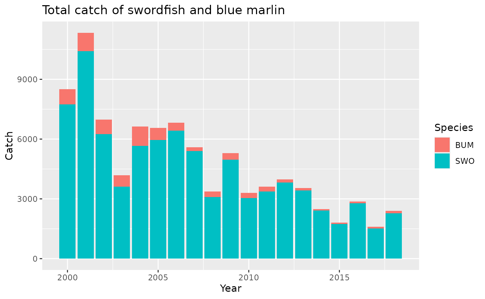

# Data formatting

The BycatchEstimator package assumes that there are two data sets, read
into R as either data frames or tibbles:

1.  A sample of the fishery from, for example, an observer program or
    observations at fishing ports, hereafter called the observer data.
    This dataset must have rows corresponding to fishing operations
    (e.g. sets) or trips, and columns for the total effort (e.g. number
    of hooks, number of fishing hours), as well as any important
    stratification variables (Year, spatial area, gear type, season).
    Ideally, this data should be a random or stratified random sample,
    and should be representative of the fishery.

2.  A complete record of the effort in the fishery, from a logbooks,
    landing records, or other sources. This dataset must include total
    effort, and the same stratification variables as the observer data.
    This dataset can be in the same format as the logbook data (one row
    per trip or set), or can optionally be aggregated (e.g. on row per
    combination or Year, season area, etc. )

Many fisheries datasets are not in the correct format for analysis and
require some data manipulation. For example, they may be “long” format,
where each set has a new row for each species caught , like this:

| Year | Trip   | Set | Species | Catch |
|:-----|:-------|:----|:--------|:------|
| 2001 | AB1001 | 1   | BUM     | 1     |
| 2001 | AB1001 | 1   | SWO     | 5     |
| 2001 | AB1001 | 2   | SWO     | 9     |
| 2001 | AB1001 | 3   | BUM     | 1     |
| 2001 | AB1001 | 3   | SWO     | 7     |

Long format is efficient for storing data, but it will not work with the
estimation methods. The data must be converted to “wide” format, like
this.

| Year | Trip   | Set | BUM | SWO |
|:-----|:-------|:----|:----|:----|
| 2001 | AB1001 | 1   | 1   | 5   |
| 2001 | AB1001 | 2   | 0   | 9   |
| 2001 | AB1001 | 3   | 1   | 7   |

This is the same information, but now with one row per set, and one
column per species, with zeros for sets that caught no blue marlin
(BUM).

The following shows several methods for converting between wide and
several kinds of long format in R tidyverse (Wickham et al. (2019)).The
topics covered are converting between wide and long, aggregating by
counting or summing over rows, and combining multiple datasets with
left_join. You may not need all, or any, of these methods depending on
the format of your data, but they are all here in case any of them are
useful.

We will use an example dataset from a simulated longline fishery from
the BycatchEstimator package.

This first chunk opens the tidyverse and BycatchEstimator libraries and
makes a simplified version of the logbook data for the purposes of the
tutorial.

``` r

library(tidyverse)
library(BycatchEstimator)
obsdat<-LLSIM_BUM_Example_observer%>%
  dplyr::select(trip,Year,fleet,hooks,sets,season,area,SWO,BUM) %>%
  filter(Year>1999)
```

The functions for converting between wide and long format are called
pivot_wider and pivot_longer. For linear models, including in
BycatchEstimator, data should be in wide format, meaning one row per
sample unit (e.g. set or trip). The ggplot function prefers long format,
so you often need convert between long and wide.

The first code chunk converts the LLSIM observer data from long format
to wide format. The original wide format data has columns called “SWO”,
“BUM” that include the catch of swordfish and blue marlin, respectively.
The pivot_longer function will make a new column called “Species” to
hold the values “SWO” and “BUM”, which are the names of the columns
being “pivoted”. The values in those columns will go in a column named
“Catch”. See the help file for pivot_longer for the syntax. Note that
the names of the new columns have to be a character string (i.e. in
quotes) because they are not defined in the dataframe.

``` r

?pivot_longer
obsdatLong<-pivot_longer(obsdat,
                         cols=c(SWO,BUM),
                         names_to="Species",
                         values_to="Catch")
```

The new dataset is longer because each trip now has two rows, one for
each species. All other columns have been replicated.

``` r

dim(obsdat)
```

    ## [1] 2147    9

``` r

dim(obsdatLong)
```

    ## [1] 4294    9

``` r

head(obsdatLong)
```

    ## # A tibble: 6 × 9
    ##   trip                  Year fleet hooks  sets season area  Species Catch
    ##   <chr>                <dbl> <dbl> <dbl> <dbl>  <dbl> <chr> <chr>   <dbl>
    ## 1 101.2000.6.1.25.-80   2000     1  5.10     6      2 N     SWO         0
    ## 2 101.2000.6.1.25.-80   2000     1  5.10     6      2 N     BUM         0
    ## 3 101.2001.10.1.25.-80  2001     1  0.8      1      4 N     SWO         0
    ## 4 101.2001.10.1.25.-80  2001     1  0.8      1      4 N     BUM         1
    ## 5 101.2001.11.1.30.-70  2001     1  0.4      1      4 N     SWO         2
    ## 6 101.2001.11.1.30.-70  2001     1  0.4      1      4 N     BUM         0

This is now the right format for making a ggplot, for example:

``` r

ggplot(obsdatLong,aes(x=Year,y=Catch,fill=Species))+
  geom_col()+
  ggtitle("Total catch of swordfish and blue marlin")
```



This kind of long format is quite common in input data from observer
programs, scientific surveys, etc. If there is exactly one row per
species per set, we can pivot from long to wide using pivot_wider. The
input names_from is the column containing the categorical variables
which will be used to give names to the new columns, and values_from
will be the values in the new columns (note: no quotes because these are
existing columns). The input values_fill optionally specifies that, if
there is no row for a species in a set, a zero will be filled in.

``` r

?pivot_wider
obsdatWide<-obsdatLong %>% pivot_wider(names_from=Species,
                                       values_from=Catch,
                                       values_fill=0) 
```

This only works with exactly one row per species and sample unit. In the
case where there might be more than one catch record per species and
sample unit, you may need to add them using group_by() %\>%
summarize().The group_by %\>% summarize syntax removes all variables not
mentioned explicitly in group_by or summarize, so we need to mention
them all to keep them. Finally, I will use ungroup to remove the
grouping because grouping can cause problems later when using the
dataframe for other purposes. This aggregated data can then be used in
the pivot_wider function. This dataset doesn’t need this step, but here
is the code in case you need it.

``` r

obsdatLongAgg<-obsdatLong %>% group_by(trip,Year,fleet,hooks,sets,Species) %>%
  summarize(Catch=sum(Catch))%>%
  ungroup()
dim(obsdatLongAgg)
```

    ## [1] 4294    7

``` r

dim(obsdatLong)
```

    ## [1] 4294    9

This made no change in the example data, because the data were already
aggregrated.

Another common data format, for example when the data include fish
lengths, has a separate row for each individual fish. The next chunk
uses the uncount function to make a dataset with one row per fish, so we
can see how to aggregate it into the format we need.

``` r

obsdatUncount<-obsdatLong %>%
  uncount(Catch)
dim(obsdatUncount)
```

    ## [1] 90882     8

``` r

head(obsdatUncount)
```

    ## # A tibble: 6 × 8
    ##   trip                  Year fleet hooks  sets season area  Species
    ##   <chr>                <dbl> <dbl> <dbl> <dbl>  <dbl> <chr> <chr>  
    ## 1 101.2001.10.1.25.-80  2001     1  0.8      1      4 N     BUM    
    ## 2 101.2001.11.1.30.-70  2001     1  0.4      1      4 N     SWO    
    ## 3 101.2001.11.1.30.-70  2001     1  0.4      1      4 N     SWO    
    ## 4 101.2002.11.1.25.-70  2002     1  4.19    14      4 N     SWO    
    ## 5 101.2002.11.1.25.-70  2002     1  4.19    14      4 N     SWO    
    ## 6 101.2002.11.1.25.-70  2002     1  4.19    14      4 N     SWO

We now have a very long dataset in which there is one row per individual
fish and no Catch column. For example, the 2 swordfish caught in trip
101.2001.11.1.30.-70 are now in row 2 and 3, with “SWO” in the Species
column.

To get this back to wide format for running linear models, we can group
the data by trip and species, using group_by, and count the number of
rows (which is the number of fish) using the n() function in the
summarize function.

``` r

obsdatRegroup<-obsdatUncount %>% group_by(trip,Year,fleet,hooks,sets,Species) %>%
  summarize(Catch=n())%>%
  ungroup()
```

This dataset now has a Catch column with counts of swordfish and blue
marlin

``` r

head(obsdatRegroup)
```

    ## # A tibble: 6 × 7
    ##   trip                  Year fleet hooks  sets Species Catch
    ##   <chr>                <dbl> <dbl> <dbl> <dbl> <chr>   <int>
    ## 1 101.2001.10.1.25.-80  2001     1  0.8      1 BUM         1
    ## 2 101.2001.11.1.30.-70  2001     1  0.4      1 SWO         2
    ## 3 101.2002.11.1.25.-70  2002     1  4.19    14 SWO        22
    ## 4 101.2002.5.1.25.-85   2002     1  1.6      2 SWO        11
    ## 5 101.2003.4.1.25.-85   2003     1  2.65     3 SWO         5
    ## 6 101.2006.6.1.25.-85   2006     1  3.22     4 BUM         1

We can now pivot wider to get in the correct format for linear models.

``` r

obsdatRegroupWide<-obsdatRegroup %>% pivot_wider(names_from = Species,
                                                 values_from = Catch,
                                                 values_fill = 0)
head(obsdatRegroupWide)
```

    ## # A tibble: 6 × 7
    ##   trip                  Year fleet hooks  sets   BUM   SWO
    ##   <chr>                <dbl> <dbl> <dbl> <dbl> <int> <int>
    ## 1 101.2001.10.1.25.-80  2001     1  0.8      1     1     0
    ## 2 101.2001.11.1.30.-70  2001     1  0.4      1     0     2
    ## 3 101.2002.11.1.25.-70  2002     1  4.19    14     0    22
    ## 4 101.2002.5.1.25.-85   2002     1  1.6      2     0    11
    ## 5 101.2003.4.1.25.-85   2003     1  2.65     3     0     5
    ## 6 101.2006.6.1.25.-85   2006     1  3.22     4     1    22

The data frame is now in wide format, and values_fill put zeros for the
catch species not found in each trip. However, we still have a problem.
We don’t have as many rows in this table as in the original obsdat.

``` r

dim(obsdatRegroupWide)
```

    ## [1] 2049    7

``` r

dim(obsdat)
```

    ## [1] 2147    9

And if we look, we can see that the missing rows are those with no
catches of either swordfish or blue marlin. The following code filters
obsdat to the trip numbers that are not in obsdatRegroupWide and looks
at the first few rows.

``` r

head(filter(obsdat,!trip %in% obsdatRegroupWide$trip))
```

    ## # A tibble: 6 × 9
    ##   trip                  Year fleet hooks  sets season area    SWO   BUM
    ##   <chr>                <dbl> <dbl> <dbl> <dbl>  <dbl> <chr> <dbl> <dbl>
    ## 1 101.2000.6.1.25.-80   2000     1 5.10      6      2 N         0     0
    ## 2 101.2001.7.1.35.-65   2001     1 0.3       1      3 N         0     0
    ## 3 101.2012.8.1.25.-85   2012     1 0.8       1      3 N         0     0
    ## 4 103.2004.11.1.25.-75  2004     1 0.402     1      4 N         0     0
    ## 5 106.2005.10.1.30.-75  2005     1 0.552     1      4 N         0     0
    ## 6 106.2008.2.1.25.-85   2008     1 1.8       2      1 N         0     0

These rows in the original data indicating zero catches are needed for
our linear models to estimate abundance trends or bycatch rates.
However, they cannot be calculated from a long format dataset that has
no rows for zero observations.

Often datasets from observer programs and surveys will have one table
containing observations for each sample unit (e.g. set, trip, transect),
including, time, date, location, etc., and have a separate table for the
information on the individual animals observed. The data might be
formatted like this:

``` r

tripTable<-dplyr::select(obsdat,trip,sets,hooks,sets,season,area)
head(tripTable)
```

    ## # A tibble: 6 × 5
    ##   trip                  sets hooks season area 
    ##   <chr>                <dbl> <dbl>  <dbl> <chr>
    ## 1 101.2000.6.1.25.-80      6  5.10      2 N    
    ## 2 101.2001.10.1.25.-80     1  0.8       4 N    
    ## 3 101.2001.11.1.30.-70     1  0.4       4 N    
    ## 4 101.2001.7.1.35.-65      1  0.3       3 N    
    ## 5 101.2002.11.1.25.-70    14  4.19      4 N    
    ## 6 101.2002.5.1.25.-85      2  1.6       2 N

``` r

animalTable<-dplyr::select(obsdatUncount,trip,Species)%>%
  mutate(length=NA,
         weight=NA)
head(animalTable)
```

    ## # A tibble: 6 × 4
    ##   trip                 Species length weight
    ##   <chr>                <chr>   <lgl>  <lgl> 
    ## 1 101.2001.10.1.25.-80 BUM     NA     NA    
    ## 2 101.2001.11.1.30.-70 SWO     NA     NA    
    ## 3 101.2001.11.1.30.-70 SWO     NA     NA    
    ## 4 101.2002.11.1.25.-70 SWO     NA     NA    
    ## 5 101.2002.11.1.25.-70 SWO     NA     NA    
    ## 6 101.2002.11.1.25.-70 SWO     NA     NA

In this case all the information about each trip is in the table called
trip, and information about individual animals is in the animalTable. To
get the count of animals of each species, including zeros, we do two
steps.

1.  Use group_by %\>% summarize to count all the animals in the non-zero
    trips in the animals table

2.  Use left_join to add the counts onto the full trip table, filling in
    zeros for trips with no animals caught.

Step 1 is the same analysis we did before to make obsdatRegroupWide,
except in that in this case, we don’t want to include any variables
other than trip and the catch of each species. We can ignore variables
like animal length and weight, and we don’t want to duplicate any
variables already in tripTable (except those used in matching rows, as
shown below).

``` r

animalCatch<-animalTable %>% group_by(trip,Species) %>%
  summarize(Catch=n())%>%
  ungroup()
animalCatchWide <-animalCatch %>%pivot_wider(names_from = Species,
                                             values_from = Catch,
                                             values_fill = 0)
dim(animalCatchWide)
```

    ## [1] 2049    3

``` r

dim(tripTable)
```

    ## [1] 2147    5

We see from the dimensions that there are 98 trips missing. So, we now
add catch to tripTable using left_join. Left join will use the trip
variable (by=trip) present in both datasets to match the rows. It will
keep all the rows in tripTable (the left table in the left_join).

``` r

?left_join
finalTable<-left_join(tripTable,animalCatchWide,by="trip")
summary(finalTable)
```

    ##         trip           sets           hooks            season     
    ##  Length   :2147   Min.   : 1.00   Min.   :  0.01   Min.   :1.000  
    ##  N.unique :2147   1st Qu.: 4.00   1st Qu.:  4.00   1st Qu.:1.000  
    ##  N.blank  :   0   Median :15.00   Median : 22.08   Median :2.000  
    ##  Min.nchar:  16   Mean   :15.79   Mean   : 32.45   Mean   :2.465  
    ##  Max.nchar:  24   3rd Qu.:20.00   3rd Qu.: 51.20   3rd Qu.:4.000  
    ##                   Max.   :99.00   Max.   :258.98   Max.   :4.000  
    ##                                                                   
    ##         area           BUM               SWO         
    ##  Length   :2147   Min.   :  0.000   Min.   :   0.00  
    ##  N.unique :   2   1st Qu.:  0.000   1st Qu.:   7.00  
    ##  N.blank  :   0   Median :  1.000   Median :  20.00  
    ##  Min.nchar:   1   Mean   :  3.413   Mean   :  40.94  
    ##  Max.nchar:   1   3rd Qu.:  3.000   3rd Qu.:  40.00  
    ##                   Max.   :108.000   Max.   :1256.00  
    ##                   NAs    :98        NAs    :98

We see that there are 98 NA values of BUM and SWO, for the trips that
were now match. We just need to replace those with zeros, as they are
trips that caught no swordfish or blue marlin.

``` r

finalTable<-finalTable %>%
  mutate(across(BUM:SWO,~replace_na(.x,0)))
summary(finalTable)
```

    ##         trip           sets           hooks            season     
    ##  Length   :2147   Min.   : 1.00   Min.   :  0.01   Min.   :1.000  
    ##  N.unique :2147   1st Qu.: 4.00   1st Qu.:  4.00   1st Qu.:1.000  
    ##  N.blank  :   0   Median :15.00   Median : 22.08   Median :2.000  
    ##  Min.nchar:  16   Mean   :15.79   Mean   : 32.45   Mean   :2.465  
    ##  Max.nchar:  24   3rd Qu.:20.00   3rd Qu.: 51.20   3rd Qu.:4.000  
    ##                   Max.   :99.00   Max.   :258.98   Max.   :4.000  
    ##         area           BUM               SWO         
    ##  Length   :2147   Min.   :  0.000   Min.   :   0.00  
    ##  N.unique :   2   1st Qu.:  0.000   1st Qu.:   6.00  
    ##  N.blank  :   0   Median :  1.000   Median :  18.00  
    ##  Min.nchar:   1   Mean   :  3.258   Mean   :  39.07  
    ##  Max.nchar:   1   3rd Qu.:  3.000   3rd Qu.:  39.00  
    ##                   Max.   :108.000   Max.   :1256.00

We now have the correct zero catches in the table. We can confirm that
this process recreated the exact same data that was in the original
obsdat, as follows:

``` r

table(obsdat$BUM==finalTable$BUM)
```

    ## 
    ## TRUE 
    ## 2147

``` r

table(obsdat$SWO==finalTable$SWO)
```

    ## 
    ## TRUE 
    ## 2147

Wickham, Hadley, Mara Averick, Jennifer Bryan, et al. 2019. “Welcome to
the tidyverse.” *Journal of Open Source Software* 4 (43): 1686.
<https://doi.org/10.21105/joss.01686>.
