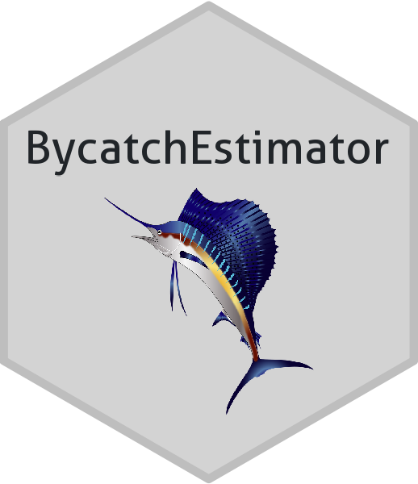

# BycatchEstimator 

BycatchEstimator uses both model-based and design-based procedures to
estimate total annual bycatch by expanding a sample, such as an observer
database, to the total effort from logbooks or landings records. The
model framework can also be used to estimate an annual index of
abundance, calculated only from the observer data. See the User’s Guide
under articles at the [bycatchEstimator
site](https://ebabcock.github.io/BycatchEstimator/) for details. The
source code is at the [GitHub
site](https://github.com/ebabcock/BycatchEstimator). For a development
version of a Shiny app that runs the data checks described below, click
[here](https://natureanalytics.shinyapps.io/BycatchEstimator/).

## Installation

The code runs best in RStudio. Before running the code for the first
time, install the latest versions of [R](https://cran.r-project.org/)
and [RStudio](https://posit.co/downloads).

You can install the development version of BycatchEstimator from
[GitHub](https://github.com/ebabcock/BycatchEstimator) with:

``` r

# install.packages("devtools")
devtools::install_github("ebabcock/BycatchEstimator")
#> Using GitHub PAT from the git credential store.
#> Skipping install of 'BycatchEstimator' from a github remote, the SHA1 (fb032c94) has not changed since last install.
#>   Use `force = TRUE` to force installation
```

For more help with installation, see the [Installation
Guide](https://ebabcock.github.io/BycatchEstimator/).

If you have used older versions of this tool, see the the articles on
how to adjust your code to use the new version under articles at the
BycatchEstimaor [website](https://ebabcock.github.io/BycatchEstimator/).

## Getting started

``` r

library(BycatchEstimator)
```

To demonstrate its use, example data sets are included in this R
package, based on a simulated longline dataset from LLSIM (Goodyear,
2021). The LLSIM data was used for extensive simulation-testing of this
bycatch estimation tool (Babcock and Goodyear, 2021; Babcock et
al. 2022, 2023). The data include trip- by-trip data from an observer
program covering 5% of the fishing effort, as well as a trip-by-trip
logbook data from the whole fishery, with multiple potential predictor
variables and catches of swordfish (target) and blue marlin (bycatch).
For more information on how to format your own data to use the tool, see
the tutorial on [Data
formatting](https://ebabcock.github.io/BycatchEstimator/articles/Data_Formatting)

``` r

head(LLSIM_BUM_Example_observer)
head(LLSIM_BUM_Example_logbook)
```

### Data setup

The first step in bycatch estimation is to set up the input file and
review the data. The returned value from `bycatchSetup` is assigned as
an object that will be used in subsequent steps. This first step also
produces an html output (default) that is saved to the working directory
for the user to review. This html output contains summary figures and
tables showing the sample size and presence/absence of the bycatch
species across levels of predictor variables, observer coverage levels,
and raw trends in CPUE. `bycatchSetup` will also indicate if there are
missing data or NAs with warning messages to the console and printed
messages in the html output.

``` r

setupObj<-bycatchSetup(
  obsdat = droplevels(LLSIM_BUM_Example_observer[LLSIM_BUM_Example_observer$Year>2010 &LLSIM_BUM_Example_observer$fleet==2,]),
  logdat = droplevels(LLSIM_BUM_Example_logbook[LLSIM_BUM_Example_logbook$Year>2010 & LLSIM_BUM_Example_logbook$fleet==2,]),
  yearVar = "Year",
  obsEffort = "hooks",
  logEffort = "hooks",
  latitudeVar = "lat",
  longitudeVar = "lon",
  spatialBin = 5,
  obsCatch = c("SWO","BUM")[2], # selecting Blue marlin catch
  catchUnit = "number",
  catchType = "catch",
  logNum = NA,
  sampleUnit = "trips",
  factorVariables = c("Year","area","season"),
  numericVariables = NA,
  EstimateBycatch = TRUE,
  baseDir = getwd(),
  runName = "LLSIMBUMtripExample",
  runDescription = "LLSIMBUM by trip",
  common = c("Swordfish","Blue marlin")[2], # selecting Blue marlin
  sp = c("Xiphias gladius","Makaira nigricans")[2], # selecting Blue marlin
  reportType = "html"
)
```

### Design-based estimators

Estimation of bycatch using design-based estimators is done with
`bycatchDesign`, requiring the output of `bycatchSetup` and other
inputs. This uses a stratified ratio estimator or stratified
delta-lognormal estimator, with stratification variables defined by the
user. To deal with strata that have no observations or few observations,
the user may request pooling, and specify the minimum number of sample
units needed to avoid pooling. The input groupVar is a character vector
of the names of variables to be used to group the output into useful
summaries. `bycatchDesign` also produces an html or pdf output with
results to the specified directory.

``` r

designObj <- bycatchDesign(
  setupObj = setupObj,
  designScenario = "noPool",
  groupVar =  c("Year","area"),
  designMethods = c("Ratio", "Delta"),
  designVars = c("Year","area","season"),
  designPooling = FALSE,
  poolTypes=c("adjacent","all","none"),
  pooledVar=c(NA,NA),
  adjacentNum=c(1,NA),
  minStrataUnit = 1,
  reportType="html"
)
```

### Model-based estimators

Estimation of bycatch and/or and index of abundance is carried out by
using the function `bycatchFit`. This function requires an object
produced by `bycatchSetup`. Bycatch estimation is carried out by running
linear models based on user-defined observation error models
(e.g. delta-lognormal, and negative binomial) with predictor variables
(e.g., year, season, depth). The task of identifying a best
approximating model is addressed through a semi-automated model
selection process based on the user’s choice of information criteria
(AICc, AIC or BIC) and cross validation. Once a best approximating model
is identified, the model is used to predict total bycatch in all logbook
trips and bycatch is summed across trips. The user needs to define the
most complex model configuration and simple model configuration, and the
function will fit all models in between.The total bycatch is estimated
for each combination of the variables specified in “PredictionGroups”,
as well as (generally) by Year. The default method for variance
calculation is the delta method, but other options are available.
`bycatchFit` also produces an html or pdf output with results to the
specified directory.

``` r

bycatchFit(
  setupObj = setupObj,
  modelScenario = "s1",
  predictionGroups=c("Year","area"),
  complexModel = formula(y~Year+area),
  simpleModel = formula(y~Year),
  indexModel = formula(y~Year),
  modelTry = c("TMBnbinom1","TMBtweedie"),
  randomEffects = NULL,
  randomEffects2 = NULL,
  selectCriteria = "BIC",
  DoCrossValidation = TRUE,
  CIval = 0.05,
  VarCalc = "DeltaMethod",
  useParallel = TRUE,
  nSims = 100,
  plotValidation = FALSE,
  trueVals = NULL,
  trueCols = NULL,
  reportType = "html"
)
```

### Optionally reload model results for plotting

The function `loadOutputs` reads in all the R objects from the analysis,
as well as a data frame called allYearEstimates appropriate for plotting
with ggplot.

``` r

allResults<-loadOutputs(baseDir = getwd(),
                      runName= "LLSIMBUMtripExample",
                      runDate =  Sys.Date(),
                      designScenarios = "noPool",
                      modelScenarios = "s1"
)
#Plot all together
ggplot(allResults$allYearEstimates,aes(x=Year,y=Total,
                                       ymin=TotalLCI,ymax=TotalUCI,
                      fill=Source,color=Source))+
  geom_line()+
  geom_ribbon(alpha=0.4)+
  theme_bw()
```

See the [User
Guide](https://ebabcock.github.io/BycatchEstimator/articles/UserGuide2.html)
for more details, analysis options, and examples.

## References

Goodyear, C.P. 2021. Development of new model fisheries for simulating
longline catch data with LLSIM. Collect. Vol. Sci. Pap. ICCAT, 78(5):
53-62

Babcock, E.A. and C. P. Goodyear. 2021. Testing a bycatch estimation
tool using simulated blue marlin longline data. ICCAT Collective Volume
of Scientific Papers, 78(5): 179-189.

Babcock E. A., W. J. Harford, T. Gedamke, D. Soto, and C. P. Goodyear.
2022. Efficacy of a bycatch estimation tool. ICCAT Collective Volume of
Scientific Papers 79(5): 304-339

Babcock, E. A., W. J. Harford, T. Gedamke, S. Anderson, and C. P.
Goodyear. 2023. Simulation-Testing Model-Based and Design-Based Bycatch
Estimators. ICCAT Collective Volume of Scientific Papers 80 (6): 51–79.
